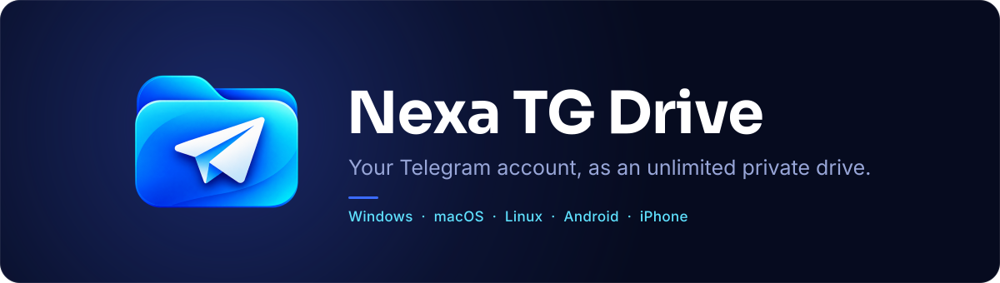
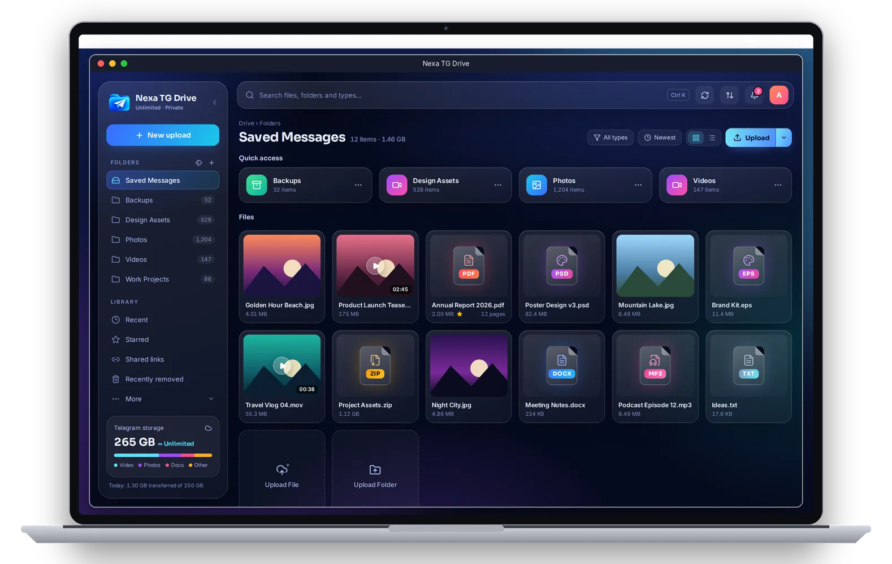
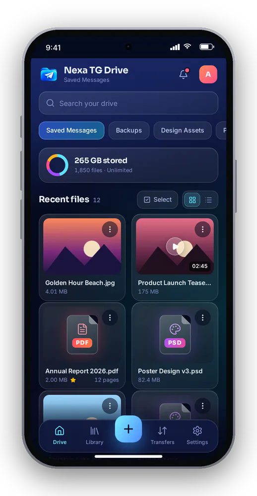
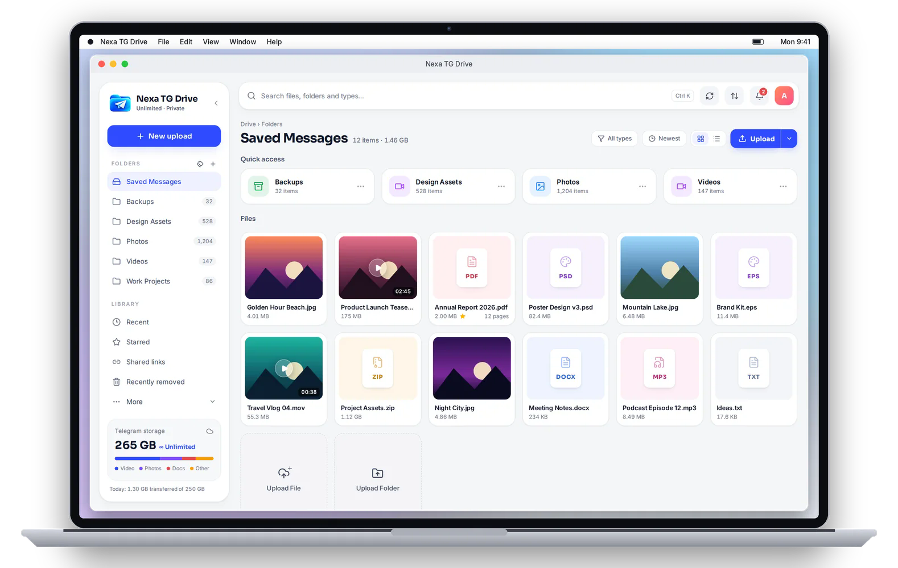
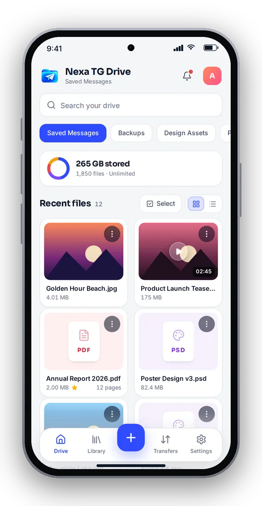
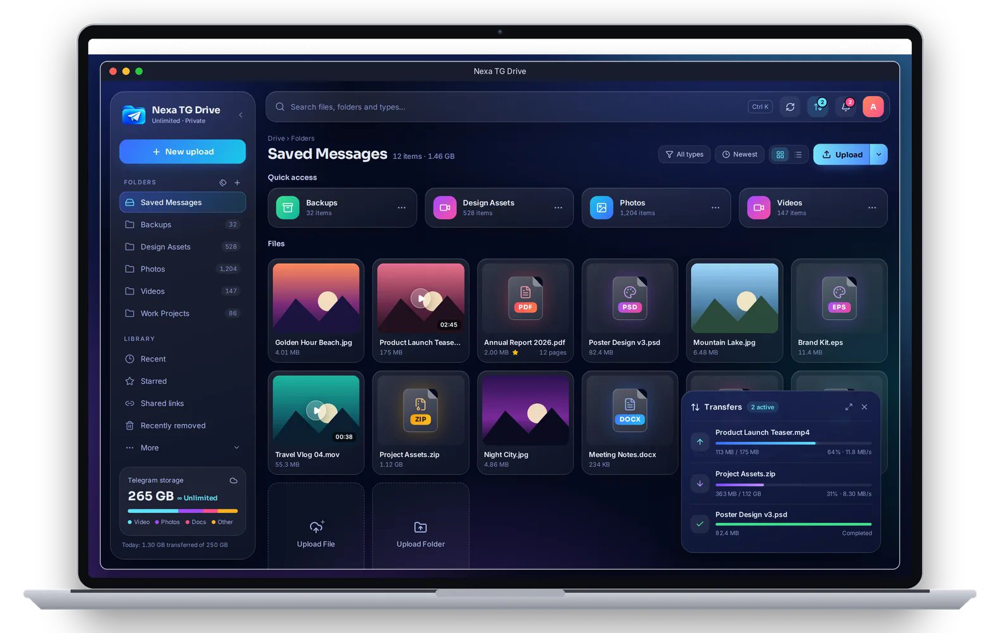
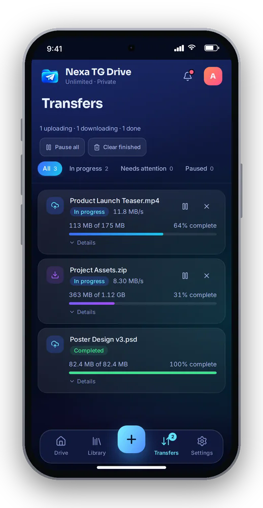
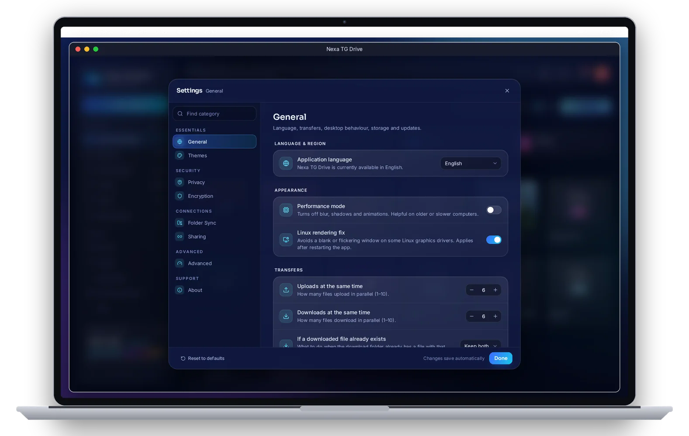
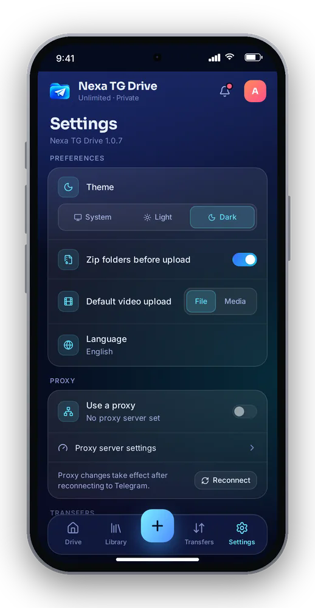

<p align="center">
  
</p>

<p align="center">
  <a href="https://nexatgdrive.pages.dev/"></a>
  
  
  <a href="https://nexatgdrive.pages.dev/"></a>
</p>

<p align="center">
  <a href="https://nexatgdrive.pages.dev/">Website</a> &nbsp;·&nbsp;
  <a href="https://nexatgdrive.pages.dev/">Download</a> &nbsp;·&nbsp;
  <a href="#features">Features</a> &nbsp;·&nbsp;
  <a href="#screenshots">Screenshots</a> &nbsp;·&nbsp;
  <a href="#get-started">Get started</a> &nbsp;·&nbsp;
  <a href="#iphone-ios-15">iPhone</a> &nbsp;·&nbsp;
  <a href="#platform-support">Platforms</a> &nbsp;·&nbsp;
  <a href="#faq">FAQ</a> &nbsp;·&nbsp;
  <a href="#privacy">Privacy</a>
</p>

<br>

<p align="center">
  
  &nbsp;
  
</p>
<p align="center"><sub>Desktop &nbsp;·&nbsp; Phone</sub></p>

<br>

**Nexa TG Drive** turns your own Telegram account into a personal cloud drive. Saved Messages is your home, every channel is a folder, and your files stay in your account — on Windows, macOS, Linux, Android and iPhone.

<table>
  <tr>
    <td width="25%" valign="top"><br><b>Unlimited space</b><br><sub>Files live in your own Telegram account.</sub></td>
    <td width="25%" valign="top"><br><b>Private by design</b><br><sub>Optional encryption. Keys never leave your device.</sub></td>
    <td width="25%" valign="top"><br><b>Stream instantly</b><br><sub>Watch and listen without a full download.</sub></td>
    <td width="25%" valign="top"><br><b>Free, no ads</b><br><sub>Every feature, for everyone. No paywall.</sub></td>
  </tr>
</table>

## How it works

<table>
  <tr>
    <td width="33%" valign="top"><b>1&nbsp;&nbsp;Connect</b><br><sub>Sign in with your own Telegram account. Nothing to rent, no new cloud account.</sub></td>
    <td width="33%" valign="top"><b>2&nbsp;&nbsp;Organise</b><br><sub>Saved Messages becomes home. Each private channel becomes a folder.</sub></td>
    <td width="33%" valign="top"><b>3&nbsp;&nbsp;Store and stream</b><br><sub>Upload, preview and stream from any device signed in to the same account.</sub></td>
  </tr>
</table>

## Screenshots

The same layout on every screen, in dark and light.

<p align="center">
  
  &nbsp;
  
</p>
<p align="center"><sub>Light theme</sub></p>

<p align="center">
  
  &nbsp;
  
</p>
<p align="center"><sub>Transfers — pause, resume and live progress</sub></p>

<p align="center">
  
  &nbsp;
  
</p>
<p align="center"><sub>Settings</sub></p>

## Features

Everything below is built into the app — free, for every user.

<table>
  <tr>
    <td width="50%" valign="top">
      <br>
      <b>Drive and files</b><br>
      <sub>Saved Messages is home. Every channel is a folder.</sub>
      <ul>
        <li>Create, rename and delete folders</li>
        <li>Grid and list views, sorting and filters</li>
        <li>Drag-and-drop upload, upload from a URL</li>
        <li>Move files between folders, multi-select actions</li>
        <li>Download single files or whole folders</li>
        <li>Fast local search across your drive</li>
      </ul>
    </td>
    <td width="50%" valign="top">
      <br>
      <b>Transfers</b><br>
      <sub>A queue built to finish what it starts.</sub>
      <ul>
        <li>Survives app restarts</li>
        <li>Pause, resume, retry and cancel</li>
        <li>Automatic retry on network drops</li>
        <li>Concurrency and speed limits</li>
        <li>Live progress in a dedicated transfer panel</li>
        <li>Desktop notifications and a tray icon</li>
      </ul>
    </td>
  </tr>
  <tr>
    <td width="50%" valign="top">
      <br>
      <b>Preview and streaming</b><br>
      <sub>Open files without waiting for the download.</sub>
      <ul>
        <li>Stream video and audio straight from Telegram</li>
        <li>Resume where you stopped, with “Continue watching”</li>
        <li>Image viewer and PDF viewer</li>
        <li>Browse ZIP and 7z archives</li>
        <li>A clear card for file types that can’t be previewed</li>
      </ul>
    </td>
    <td width="50%" valign="top">
      <br>
      <b>Thumbnails and formats</b><br>
      <sub>See every file at a glance.</sub>
      <ul>
        <li>Instant blurred preview, then a sharp thumbnail</li>
        <li>Images, videos and the first page of PDFs</li>
        <li>Photoshop PSD and Illustrator AI previews</li>
        <li>Format tiles for everything else — PDF, DOCX, ZIP, EPS, TXT</li>
        <li>Thumbnails are cached, so they open instantly next time</li>
      </ul>
    </td>
  </tr>
  <tr>
    <td width="50%" valign="top">
      <br>
      <b>Library</b><br>
      <sub>Your files, organised beyond folders.</sub>
      <ul>
        <li>Search, Timeline and Slideshow</li>
        <li>Collections and tags</li>
        <li>Offline packs to keep files on the device</li>
        <li>Recently removed — undo a delete for a set number of days</li>
        <li>Cleanup, Storage and Activity views</li>
      </ul>
    </td>
    <td width="50%" valign="top">
      <br>
      <b>Security</b><br>
      <sub>Protection that stays on your device.</sub>
      <ul>
        <li>Optional end-to-end file encryption (XChaCha20-Poly1305, Argon2id vault)</li>
        <li>Recovery bundle and recovery drill</li>
        <li>Auto-lock for the encryption vault</li>
        <li>Encrypted settings sync through your own Telegram</li>
        <li>Android: fingerprint app lock and screen-capture block</li>
      </ul>
    </td>
  </tr>
  <tr>
    <td width="50%" valign="top">
      <br>
      <b>Folder Sync</b><br>
      <sub>Keep a local folder and a drive folder in step.</sub>
      <ul>
        <li>Backup, download or two-way sync</li>
        <li>Plan preview before anything changes</li>
        <li>Watches the folder for changes while the app runs</li>
        <li>Clear conflict handling</li>
      </ul>
    </td>
    <td width="50%" valign="top">
      <br>
      <b>Sharing and connect</b><br>
      <sub>Reach your drive from other apps.</sub>
      <ul>
        <li>Internet share links — open from anywhere while Nexa is running</li>
        <li>Choose how long a link stays active; it switches off by itself</li>
        <li>Optional password and download counter</li>
        <li>Local REST API with your own key</li>
        <li>WebDAV access (read-only by default)</li>
        <li>Local stream links for media players</li>
      </ul>
    </td>
  </tr>
  <tr>
    <td width="50%" valign="top">
      <br>
      <b>Network</b><br>
      <sub>Works on any connection.</sub>
      <ul>
        <li>SOCKS5 and HTTP proxy, with a connection test</li>
        <li>VPN-friendly mode</li>
        <li>Bandwidth schedule and weekly data quota</li>
        <li>Live connection status and latency</li>
      </ul>
    </td>
    <td width="50%" valign="top">
      <br>
      <b>Sign in your way</b><br>
      <sub>Your account, your keys.</sub>
      <ul>
        <li>QR code sign-in</li>
        <li>Phone number with a full country picker</li>
        <li>Two-step verification (2FA) password</li>
        <li>Each user signs in with their own Telegram account</li>
        <li>Stays signed in until you log out</li>
      </ul>
    </td>
  </tr>
  <tr>
    <td width="50%" valign="top">
      <br>
      <b>Always up to date</b><br>
      <sub>New versions arrive inside the app.</sub>
      <ul>
        <li>Update pop-up when a new release is out</li>
        <li>Desktop: one click to download, install and restart</li>
        <li>Android: downloads and opens the installer by itself</li>
        <li>“What’s New” shows the real release notes</li>
      </ul>
    </td>
    <td width="50%" valign="top">
      <br>
      <b>Made for Android</b><br>
      <sub>A real phone app, not a squeezed desktop.</sub>
      <ul>
        <li>Downloads saved to <code>Download/Nexa TG Drive</code></li>
        <li>Send files to Nexa from the share sheet</li>
        <li>Transfers keep running in the background</li>
        <li>Wi-Fi-only, roaming, charging and battery rules</li>
        <li>Layout that respects the status bar and gesture bar</li>
      </ul>
    </td>
  </tr>
  <tr>
    <td colspan="2" valign="top">
      <br>
      <b>Themes and layout</b><br>
      <sub>Dark and light themes with the same layout on desktop and phone, plus a Performance Mode for slower devices. Every dialog, menu and the sign-in card scales to fit the window or phone screen, so nothing is cut off.</sub>
    </td>
  </tr>
</table>

### Languages

The interface comes in **18 languages**. Pick one in *Settings › General › Language*; Arabic, Urdu and Persian use a right-to-left layout.

| | | |
| :-- | :-- | :-- |
| English — English | Bengali — বাংলা | Hindi — हिन्दी |
| Arabic — العربية | Urdu — اردو | Spanish — Español |
| Portuguese — Português | French — Français | German — Deutsch |
| Russian — Русский | Turkish — Türkçe | Indonesian — Bahasa Indonesia |
| Chinese (Simplified) — 简体中文 | Japanese — 日本語 | Korean — 한국어 |
| Italian — Italiano | Vietnamese — Tiếng Việt | Persian — فارسی |

<details>
<summary><b>What’s not included yet</b></summary>
<br>
<ul>
<li>MTProto proxies (SOCKS5 and HTTP proxies work)</li>
<li>RAR archives and HEIC images (ZIP, 7z and common image formats work)</li>
<li>Video transcoding, quality levels and casting</li>
<li>WebDAV sub-folders</li>
<li>Folder Sync runs only while the app is open</li>
</ul>
</details>

## Download

Get it from the official website **[nexatgdrive.pages.dev](https://nexatgdrive.pages.dev/)** — it detects your device and downloads the right file.

| Platform | File |
| :-- | :-- |
| macOS — Apple Silicon | `…_arm64.dmg` |
| macOS — Intel | `…_Intel.dmg` |
| Windows | `…_x64-setup.exe` |
| Linux | `.AppImage` · `.deb` · `.rpm` |
| Android | `…_android.apk` |
| iPhone (iOS 15+) | `…_iOS.ipa` — install with TrollStore, SideStore or Sideloadly, see [iPhone](#iphone-ios-15) |

## Get started

1. Open **[my.telegram.org](https://my.telegram.org)** → *API development tools* and create an app to get your **API ID** and **API Hash**.
2. Enter them in Nexa TG Drive.
3. Scan the QR code with Telegram on your phone (*Settings → Devices → Link Desktop Device*), or sign in with your phone number.

That’s it — your drive is ready.

## iPhone (iOS 15+)

Nexa TG Drive is not on the App Store, and the iPhone version is free. The release file is `Nexa.TG.Drive_<version>_iOS.ipa`. **Which way to install it depends on your iOS version** — find it in *Settings › General › About › iOS Version*.

| Your iOS version | Best way | What it means |
| :-- | :-- | :-- |
| **15.0 – 16.6.1**, **16.7 RC (20H18)** or **17.0** | **[TrollStore](#a--trollstore)** | Installed once and it stays. No Apple ID, no 7-day refresh, no computer for updates. |
| **16.7 – 16.7.x**, **17.0.1** or newer | **[SideStore](#b--sidestore)** | Best free way: pair once with a computer, then the phone re-signs Nexa every week by itself. |
| any iOS 15+ | **[Sideloadly](#c--sideloadly)** | Simplest to understand, but you need the computer again every 7 days. |

> On iOS versions newer than TrollStore’s, nothing free removes signing: an app signed with a free Apple ID stops opening after 7 days unless it is refreshed. SideStore does that refresh on the phone; Sideloadly does it from your computer. TrollStore only works on the versions above because Apple closed the gap it uses.

### A · TrollStore

For iOS 15.0 – 16.6.1, 16.7 RC (20H18) and 17.0 ([official list](https://github.com/opa334/TrollStore)). The installer that puts TrollStore on your phone depends on the exact version and the chip — this is a summary of the table on **[ios.cfw.guide](https://ios.cfw.guide/installing-trollstore/)**. Open it and follow the guide for your exact row.

| iOS version | iPhone 6s – X (A9 – A11) | iPhone XS / XR and newer (A12+) |
| :-- | :-- | :-- |
| 15.0 – 15.4.1 | TrollHelperOTA | TrollHelperOTA |
| 15.5 | TrollInstallerX | TrollHelperOTA |
| 15.6 – 15.6.1 | TrollInstallerX | TrollHelperOTA |
| 15.7 – 15.8.6 | TrollInstallerX | TrollInstallerX |
| 15.8.7 – 15.8.8 | TrollRestore | — |
| 16.0 – 16.6.1 | TrollInstallerX | TrollInstallerX |
| 16.7 RC (20H18) | TrollRestore | TrollRestore |
| 17.0 | TrollRestore | TrollRestore |
| 16.7 – 16.7.x, 17.0.1 and later | not supported — use SideStore | not supported — use SideStore |

Betas have their own rows on ios.cfw.guide, and iPads with an A8 chip use TrollInstallerMDC / TrollMisaka. Get TrollStore only from [opa334/TrollStore](https://github.com/opa334/TrollStore) — sites that offer it for any other iOS version are fake.

1. Install TrollStore with the installer from your row.
2. On the iPhone, tap **Download for iPhone** on [nexatgdrive.pages.dev](https://nexatgdrive.pages.dev/) to get `…_iOS.ipa`.
3. Open the file in TrollStore (share sheet › **TrollStore**, or **+** inside TrollStore) and tap **Install**.
4. **Updates:** when Nexa shows a new version, download the new `.ipa` and install it the same way. Your sign-in stays.

### B · SideStore

Works on any iOS 15+, and is the best free way on iOS versions TrollStore doesn’t support. Every user signs the app with **their own free Apple ID** — no paid developer account needed.

<details open>
<summary><b>One-time setup on a computer</b> (Windows, macOS or Linux)</summary>
<br>

1. Install **[iloader](https://iloader.app/)** on your computer.
   - Windows: install iTunes first (iloader needs its iPhone driver).
   - Linux: install `usbmuxd` if your system doesn’t have it.
2. Plug in your iPhone with a USB cable and tap **Trust** on the phone.
3. Open iloader and sign in with your Apple ID.
4. Select your iPhone and choose **SideStore (Stable)**. iloader installs SideStore and its pairing file.

</details>

<details open>
<summary><b>On the iPhone</b></summary>
<br>

1. Open **Settings › General › VPN & Device Management**, tap your Apple ID under *Developer App* and choose **Trust**.
2. iOS 16 or later: turn on **Settings › Privacy & Security › Developer Mode** and let the phone restart. (iOS 15 doesn’t have this switch — skip it.)
3. Install **LocalDevVPN** from the App Store, open it and tap **Connect**. It stays on the phone — your traffic doesn’t go anywhere.
4. Open **SideStore** and sign in with the same Apple ID.
5. Add the Nexa source in SideStore (*Sources › +*):
   ```
   https://nexatgdrive.pages.dev/sidestore.json
   ```
   Then install **Nexa TG Drive** from it.
   Or tap **Download for iPhone** on [nexatgdrive.pages.dev](https://nexatgdrive.pages.dev/) and open the `…_iOS.ipa` with SideStore (*My Apps › +*).

</details>

<details>
<summary><b>Updates and the 7-day refresh</b></summary>
<br>

- **Updates:** a new version appears in SideStore under the Nexa source. Nexa also shows an update pop-up — tap **Update** to install it with SideStore.
- **7-day refresh:** apps signed with a free Apple ID expire after 7 days. SideStore refreshes them on the phone over Wi-Fi while LocalDevVPN is connected. Open SideStore now and then to be sure.
- **Optional:** add a Shortcuts automation (for example, every day) that refreshes SideStore apps.

</details>

<details>
<summary><b>Error -80045 or -80046 when signing in</b></summary>
<br>

Apple is refusing SideStore’s default sign-in settings — your Apple ID is fine. In SideStore:

1. **Settings › User Customizations:** turn off **On-Device Anisette** and let SideStore restart.
2. **Settings › Anisette Servers:** choose **SideStore (New)**, then turn off **Enable Auto Rotation** at the bottom.
3. **User Customizations › Anisette Client Configuration:** tap **Fetch**, then **Save as Overrides**.
4. **User Customizations:** tap **Reset adi.pb** (it only clears SideStore’s sign-in data).
5. Connect LocalDevVPN and sign in again — tap **Sign In** once and wait; it can take a minute.

If these options are missing, update SideStore (run iloader again). Don’t retry many times in a row — Apple may block sign-ins for a few hours.

</details>

### C · Sideloadly

The simple fallback for any iOS 15+, from Windows or macOS.

1. Install **[Sideloadly](https://sideloadly.io/faq.html)**. Windows: use the web versions of iTunes and iCloud, not the Microsoft Store ones.
2. Download `…_iOS.ipa` on the computer, plug in the iPhone and tap **Trust**.
3. Drag the `.ipa` into Sideloadly, enter your Apple ID and start.
4. On the iPhone: **Settings › General › VPN & Device Management** → your Apple ID → **Trust**. iOS 16+: turn on **Developer Mode**.
5. Every 7 days, sideload it again with the same Apple ID — your sign-in stays. Sideloadly can also refresh it for you whenever the computer sees the phone over USB or Wi-Fi.

<details>
<summary><b>Limits to know</b></summary>
<br>

- With a free Apple ID (SideStore, Sideloadly) you can have **3 sideloaded apps** at once, and SideStore counts as one. TrollStore has no such limit.
- After a big iOS update or a reset, SideStore may need a **new pairing file**. Plug the phone into your computer and make one again with iloader.
- When Apple changes something, SideStore can stop working for a while until it is updated. Check SideStore’s GitHub page when that happens.
- Folder Sync, the tray icon and desktop notifications are desktop-only features.

</details>

## Platform support

| Feature | Windows | macOS | Linux | Android | iPhone |
| :-- | :-: | :-: | :-: | :-: | :-: |
| Drive, transfers, preview and streaming | ✓ | ✓ | ✓ | ✓ | ✓ |
| Thumbnails and format tiles | ✓ | ✓ | ✓ | ✓ | ✓ |
| Library, collections, tags | ✓ | ✓ | ✓ | ✓ | ✓ |
| File encryption | ✓ | ✓ | ✓ | ✓ | ✓ |
| QR and phone sign-in, 2FA | ✓ | ✓ | ✓ | ✓ | ✓ |
| In-app updates | ✓ | ✓ | ✓ <sub>AppImage</sub> | ✓ | ✓ <sub>update pop-up; installs via TrollStore / SideStore</sub> |
| Folder Sync with live watcher | ✓ | ✓ | ✓ | — | — |
| Internet share links, REST API, WebDAV | ✓ | ✓ | ✓ | ✓ | ✓ <sub>while open</sub> |
| Tray icon and desktop notifications | ✓ | ✓ | ✓ | — | — |
| Fingerprint lock, screen-capture block | — | — | — | ✓ | — |
| Share-sheet upload, background transfers | — | — | — | ✓ | — |
| Apple Silicon and Intel builds | — | ✓ | — | — | — |

## FAQ

<details>
<summary><b>Is it really free?</b></summary>
<br>Yes. No ads, no paywall, no premium tier. Every feature is free for everyone.
</details>

<details>
<summary><b>Where are my files stored?</b></summary>
<br>In your own Telegram account — in Saved Messages and in private channels the app creates for you. You can still see them in any Telegram app.
</details>

<details>
<summary><b>Is there a size limit?</b></summary>
<br>Telegram limits each file (2 GB on a standard account, 4 GB with Telegram Premium). There is no limit on the total number of files.
</details>

<details>
<summary><b>Why do I need an API ID and API Hash?</b></summary>
<br>Telegram asks every app to identify itself. You create them once, for free, at my.telegram.org. They stay on your device.
</details>

<details>
<summary><b>How do internet share links work?</b></summary>
<br>Create a link for any file and pick how long it stays active. The link opens from anywhere — not just your own Wi-Fi — while Nexa is running on your device, and it switches off by itself when the time is up. A password is optional. The file is sent from your device; no copy is stored on a server.
</details>

<details>
<summary><b>Why isn’t the iPhone app on the App Store?</b></summary>
<br>Publishing there needs a paid Apple developer account. Instead, you install it for free — with TrollStore on iOS 15.0 – 16.6.1, 16.7 RC and 17.0, otherwise with SideStore or Sideloadly and your own Apple ID — see <a href="#iphone-ios-15">iPhone</a>.
</details>

<details>
<summary><b>macOS says the app can’t be opened.</b></summary>
<br>Right-click the app in Applications and choose <b>Open</b>, then confirm. You only need to do this once.
</details>

## Support the developer

Nexa TG Drive is free, with no ads — and it always will be. If it helps you, a small gift keeps it growing.

<table align="center">
  <tr>
    <td align="center" width="33%"><br><b>bKash</b><br><sub>Personal · Send Money</sub><br><code>01920363264</code></td>
    <td align="center" width="33%"><br><b>Nagad</b><br><sub>Personal · Send Money</sub><br><code>01920363264</code></td>
    <td align="center" width="33%"><br><b>Rocket</b><br><sub>Personal · Send Money</sub><br><code>016192685013</code></td>
  </tr>
</table>

<p align="center"><sub>Open your bKash, Nagad or Rocket app, choose <b>Send Money</b> and paste the number. Any amount is welcome. Nobody from Nexa will ever ask for your PIN or OTP.</sub></p>

## Privacy

- Your files go straight between your device and Telegram. Nexa has no server that stores them.
- Your API Hash and session stay on your own device.
- The app sends anonymous usage stats (app version, device type, country — never your IP, account or files). You can turn this off in Settings.
- Never share your API Hash, login code or session with anyone.

Found a security issue? Please report it privately — see [SECURITY.md](SECURITY.md).

<br>

<p align="center">
  <br>
  <b>Nexa TG Drive</b><br>
  <sub>Developed by Md. Rakib Hossain</sub><br>
  <sub>© 2026 Md. Rakib Hossain · All rights reserved · <a href="LICENSE">License</a> · <a href="https://nexatgdrive.pages.dev/">Website</a></sub>
</p>
